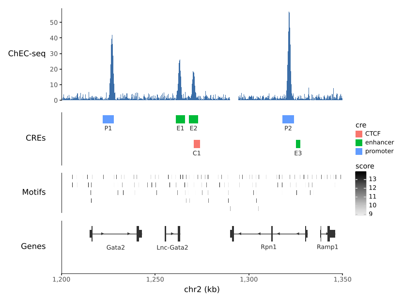

# plotnine-genomic-tracks

Genome-browser tracks as [plotnine](https://plotnine.org) layers, built on
[pygenomic_tracks](https://github.com/vmindel/pygenomic_tracks).

**Documentation: https://vmindel.github.io/plotnine_genomic_tracks/**



```python
import pygenomic_tracks as pygt
import plotnine_genomic_tracks as pgt
from plotnine import aes, ggplot, labs

region = "chr2:1,200,000-1,350,000"
x = pgt.scale_x_genome(region)

signal = ggplot() + pgt.geom_signal(chec, region, value="msn2") + x + pgt.theme_track() + labs(y="Msn2")
cres = ggplot() + pgt.geom_intervals(cres, region, aes(fill="cre"), label_by="name") + x + pgt.theme_track()
genes = ggplot() + pgt.geom_genes("mm10", region, transcripts="longest") + x + pgt.theme_track()

pgt.stack_tracks(signal, cres, genes, heights=[1.5, 0.8, 1]).save("locus.pdf", width=7, height=4)
```

| | |
|---|---|
| `scale_x_genome` | zoom to a region, ticks in bp/kb/Mb |
| `geom_signal` | signal as steps, aggregated to resolution, overlays and facets |
| `geom_intervals` | peaks, CREs, motif hits; packed rows, labels, strand, any fill scale |
| `geom_genes` | gene models from a DataFrame, GTF or genome name |
| `stack_tracks` | tracks on one x-axis, panels aligned |
| `theme_track` | genome-browser look |

Binning, packing and gene models come from `pygenomic_tracks.geometry`, so
tracks match the matplotlib ones.

## Install

```bash
pip install git+https://github.com/vmindel/plotnine_genomic_tracks
```

Needs plotnine 0.15.8 or later. Track heights in `stack_tracks` need
plotnine's development version for now
(`pip install git+https://github.com/has2k1/plotnine`).

## Claude Code skill

The package ships a skill that teaches Claude Code this API and its
pitfalls. Install it once with `pgt-install-skills`; see the
[docs](https://vmindel.github.io/plotnine_genomic_tracks/claude-skill/).

## Development

```bash
pip install -e '.[test,docs]'
pytest
python docs/gen_figures.py   # run the docs examples, refresh docs/img
mkdocs serve
```

## License

MIT
