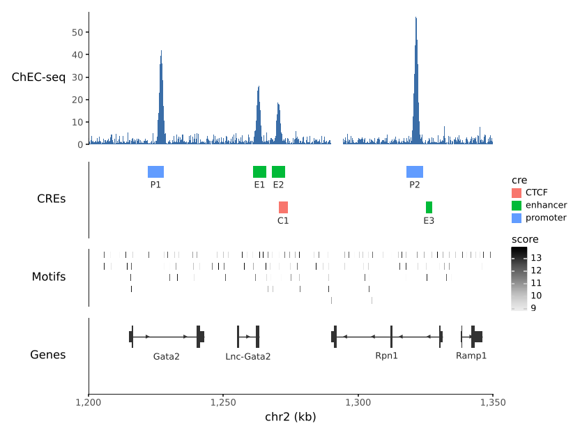

# plotnine-genomic-tracks

Genome-browser tracks as [plotnine](https://plotnine.org) layers. Signal,
interval and gene tracks are ordinary layers: they facet, take
`scale_fill_*` colours and legends, mix with any other layer, and stack
into one figure on a shared genomic axis.

The computation (binning signal to resolution, packing features and
labels into rows, reading gene models from a GTF or a genome name) is
[pygenomic_tracks](https://vmindel.github.io/pygenomic_tracks/)'s, so a
track looks the same whether you draw it with its matplotlib functions or
with plotnine.

```python
--8<-- "examples/quickstart.py"
```



## Install

```bash
pip install git+https://github.com/vmindel/plotnine_genomic_tracks
```

This installs pygenomic_tracks from GitHub as well. Setting track heights
in `stack_tracks` needs plotnine's development version (see
[Stacking tracks](layout.md)); everything else works with plotnine
0.15.8 or later.

## What is in it

| | |
|---|---|
| `scale_x_genome(region)` | Zoom to a region; ticks in bp, kb or Mb |
| `geom_signal(df, region, value=)` | Coverage, ChEC/ChIP-seq, bigWig values as steps |
| `geom_intervals(df, region)` | Peaks, CREs, motif hits; packed rows, labels, strand |
| `geom_genes(genes, region)` | Gene models from a DataFrame, GTF or genome name |
| `stack_tracks(*plots, heights=)` | Tracks stacked on one x-axis |
| `theme_track()` | Genome-browser look |

Each track function takes the table and the region, the way
pygenomic_tracks' functions do. Data goes in as `chrom`, `start`, `end`
(0-based, half-open) plus value columns; pymisha's `gextract` and
`gscreen` output works as it is.
