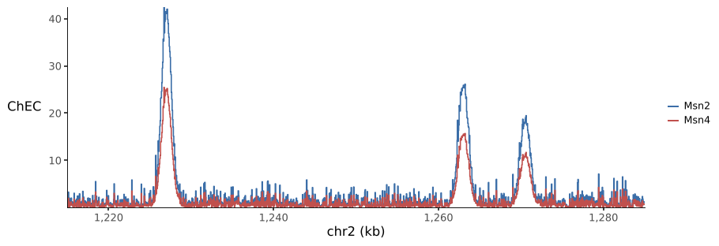
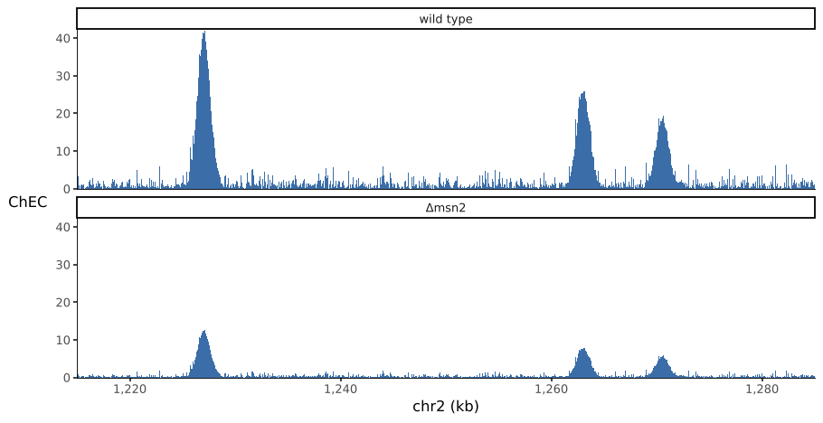
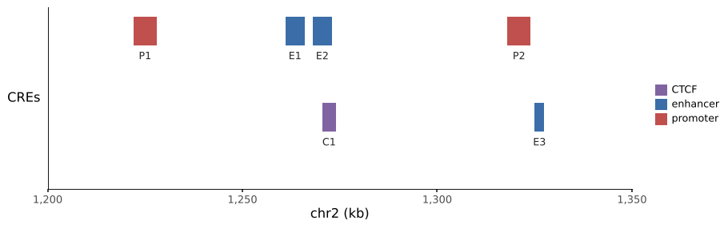
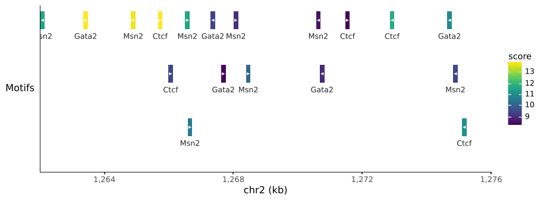
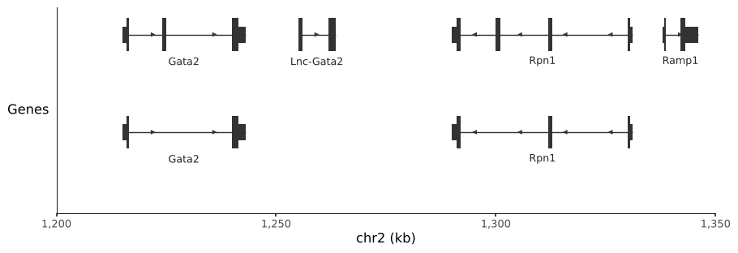
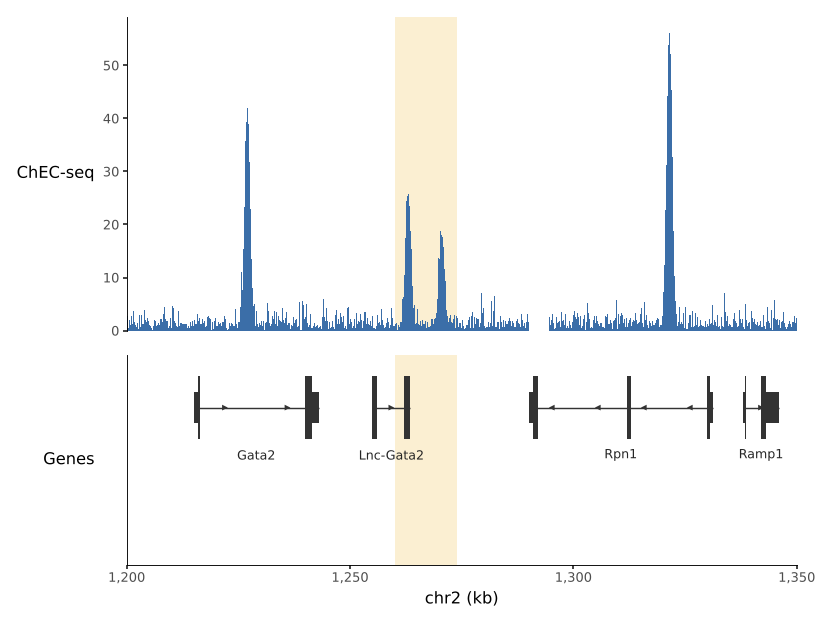

# Tracks

Every track function takes a DataFrame and a region and returns plotnine
layers, ready to add with `+`. Give each plot the same `scale_x_genome`.

A region is `"chr2:1,200,000-1,350,000"`, a `(chrom, start, end)`
tuple, or a `pygenomic_tracks.Region`; 0-based and half-open. Rows outside
it are ignored, and a table that names chromosomes `2` instead of `chr2`
(or the reverse) still matches.

## Signal

```python
--8<-- "examples/signal_overlay.py"
```



Each interval is a step over its real extent. Gaps and NaN values stay
empty, never interpolated. When there are more intervals than `n_bins`
(default 2000) or intervals overlap, they are aggregated onto `n_bins`
bins across the region with `agg="max"` (narrow peaks survive),
`"mean"` (weighted by overlap) or `"min"`.

`fill=True` draws a filled area; `fill=False` an outline. Columns named
in `mapping`, such as `aes(color="sample")`, are binned separately and
share the y scale.

To facet, pass the facet column as `by`, so it is kept and binned per
value:

```python
--8<-- "examples/signal_facets.py"
```



## Intervals

Any BED-like table: peaks, CREs, motif hits. Colour is a normal aesthetic,
so `scale_fill_manual`, `scale_fill_cmap` and legends work as usual.

```python
--8<-- "examples/intervals.py"
```



Overlapping features, and their labels, are packed into rows.
`strand=` draws arrowheads on features wide enough to hold them, and
`min_width_px` keeps short features such as motif hits visible.

```python
--8<-- "examples/motifs.py"
```



## Genes

`geom_genes` draws transcripts: an intron line, exons, thicker CDS,
strand arrowheads and names. The gene source is a DataFrame with one row
per exon/CDS, a GTF path, or a genome name (`"hg38"`, `"mm10"`,
`"sacCer3"`), which pygenomic_tracks downloads from UCSC and caches on
first use. On cluster nodes without internet, fill the cache on a login
node with `pygt download mm10`.

```python
--8<-- "examples/genes.py"
```



`transcripts="longest"` keeps one transcript per gene.

## Resolution

plotnine fixes a layer's data before it knows how wide the panel will be,
while some track decisions depend on pixels: how many signal bins, how
much room a label needs, how far apart strand arrowheads go. These
functions therefore assume a resolution:

| | Default | Meaning |
|---|---|---|
| `n_bins` (signal) | 2000 | Bins across the region; finer than any panel is wide |
| `panel_width` (features) | 6 | Inches of panel width assumed for packing |
| `dpi` (features) | 100 | Pixels per inch assumed for packing |

If labels in a narrow figure collide, lower `panel_width` to the actual
panel width. pygenomic_tracks' matplotlib functions measure the axes
instead, so the two can pack slightly differently.

## Mixing with other layers

Track plots are ordinary plots. Add `annotate`, `geom_vline` or any other
layer: here a highlight across tracks.

```python
--8<-- "examples/highlight.py"
```



`scale_x_genome` zooms with `coord_cartesian`, so data outside the region
is kept, not dropped.

Feature tracks set their own y scale (one row per packed level) and hide
the y-axis; draw each feature track as its own plot rather than adding two
feature tracks to one plot.

Dense signal tracks can be rasterised in vector output with
[plotnine-extensions](https://vmindel.github.io/plotnine_extensions/):
`rasterise(pgt.geom_signal(...), dpi=300)`.
